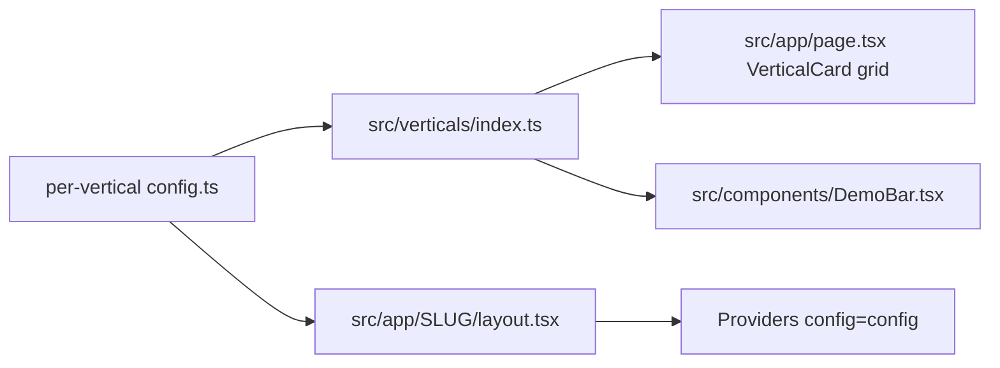
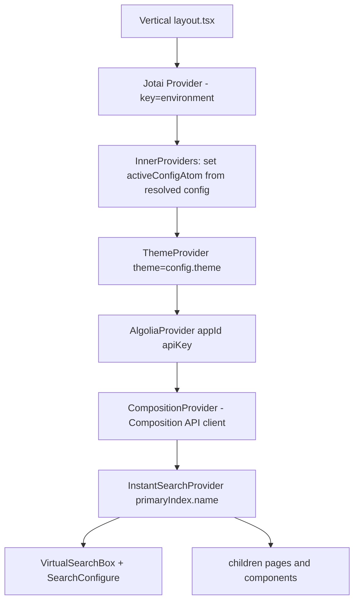
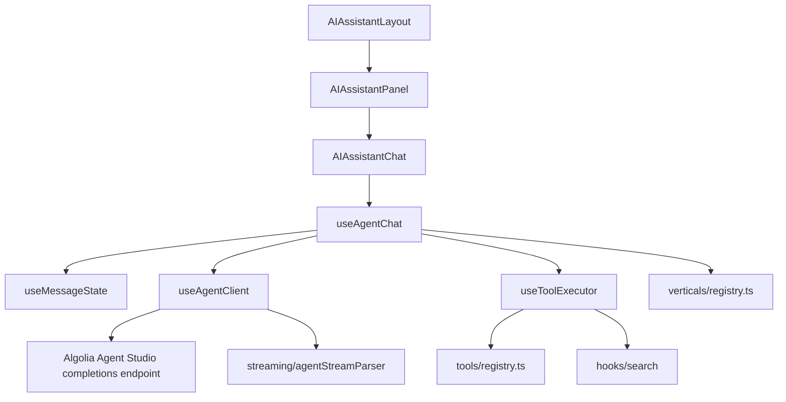
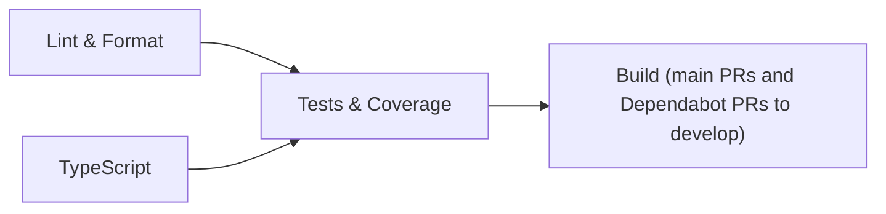
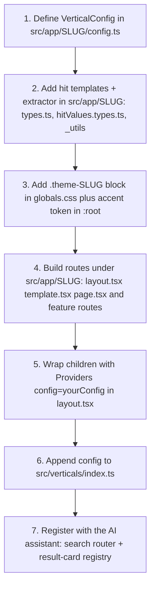

# Spencer & Williams — Architecture & Project Guide

A complete rundown of the project: what it is, how it's wired together, where things live, and how to extend it.

## Table of contents

1. [Overview](#1-overview)
2. [Repository map](#2-repository-map)
3. [Vertical architecture](#3-vertical-architecture)
4. [Routing per vertical](#4-routing-per-vertical)
5. [Provider stack](#5-provider-stack)
6. [Algolia & search UX](#6-algolia--search-ux)
7. [Demo features](#7-demo-features)
8. [AI Assistant](#8-ai-assistant)
   - [InstantSearch Chat widget](#instantsearch-chat-widget)
   - [Chat widget rollout (commerce verticals)](#chat-widget-rollout-commerce-verticals)
9. [Theming](#9-theming)
10. [State management](#10-state-management)
11. [Hooks catalogue](#11-hooks-catalogue)
12. [Tooling & configuration](#12-tooling--configuration)
13. [Testing & CI](#13-testing--ci)
14. [npm scripts](#14-npm-scripts)
15. [Adding a new vertical](#15-adding-a-new-vertical)
16. [Conventions & gotchas](#16-conventions--gotchas)

---

## 1. Overview

**Spencer & Williams** (S&W) is a multi-vertical demo platform that showcases Algolia search across several industry verticals. Each vertical is a fully self-contained Next.js App Router experience with its own configuration, theme, navigation, hit templates, and (in most cases) an AI assistant.

Verticals aren't one-offs — they fall into a few **archetypes** that share structure. New verticals almost always slot into an existing archetype:

| Archetype | Shape |
|---|---|
| **Commerce** | Storefront: PLP, PDP, collections, cart, order, store locator, affinities. Verticals differ mainly in their index, hit template, and theme. (Today: ecommerce, fashion, electronics, grocery.) |
| **Federated content** | Search across multiple indices surfaced together — tabbed/federated results with per-type cards, plus vertical-specific surfaces. Verticals share the federated-search shape but vary in content types and extras (e.g. travel adds podcasts and an interactive map). (Today: travel, b2b-content.) |

The **authoritative, always-current list of verticals is [src/verticals/index.ts](../src/verticals/index.ts)** — new verticals are always registered there. This doc describes archetypes, not a fixed roster, so **this ARCHITECTURE.md file** doesn't need editing each time a vertical is added. There is no "coming soon"/gated state; every registered vertical is live.

**Tech stack**

- **Next.js 16** (App Router, view transitions enabled)
- **React 19**
- **TypeScript** (strict)
- **Tailwind CSS v4** via PostCSS, no separate `tailwind.config.*` (themes defined in [src/app/globals.css](../src/app/globals.css) using `@theme`)
- **Algolia**: [`algoliasearch`](https://www.npmjs.com/package/algoliasearch) (lite client), [`react-instantsearch`](https://www.npmjs.com/package/react-instantsearch), [`react-instantsearch-nextjs`](https://www.npmjs.com/package/react-instantsearch-nextjs), plus the Composition API and Agent Studio (AI assistant)
- **State**: [Jotai](https://jotai.org/) for cross-tree atoms, [TanStack Query](https://tanstack.com/query/latest) for server state
- **Maps**: Mapbox GL (`mapbox-gl`) for the travel map and store locators
- **Animation**: [Motion](https://motion.dev/) (`motion/react`)
- **UI primitives**: Radix Slot, Lucide icons, CVA, `clsx`, `tailwind-merge`
- **Tests**: Vitest + Testing Library + jsdom

See [package.json](../package.json) for the full dependency list.

---

## 2. Repository map

```
spencer-and-williams/
├── public/                          Static assets (per-vertical logos / images)
├── src/
│   ├── app/                         Next.js App Router
│   │   ├── layout.tsx               Root layout (QueryProvider + DemoBar)
│   │   ├── page.tsx                 Landing page (one card per registered vertical, plus the external AEM demos and documentation links)
│   │   ├── globals.css              Tailwind v4 tokens + per-vertical themes
│   │   ├── ecommerce/               Commerce vertical (shape shared by fashion, electronics, grocery): search, category, collection, product, cart, order, stores, affinities
│   │   ├── travel/                  Federated vertical: home, articles, podcasts, map, federated search
│   │   └── b2b-content/             Federated content vertical: docs, articles, blogs, resources
│   ├── components/                  Shared UI (see below)
│   │   ├── providers/               Provider stack (Algolia / Composition / InstantSearch / Theme)
│   │   ├── header/, footer/, layout/, landing/, homepage/
│   │   ├── search/, autocomplete/, filters/, results/, hit/, pagination/
│   │   ├── product/, pdp/, category/, collection/, cart/, order/
│   │   ├── recommend/, map/, storeLocator/, composition/, options/
│   │   ├── image/, ui/
│   │   ├── DemoBar.tsx              Floating vertical-switcher
│   │   ├── PersonaSwitcher.tsx      Personalization persona picker
│   │   ├── AffinitiesView.tsx, AiSummary.tsx, HeroBanner.tsx, Carousel.tsx, Logo.tsx, BackToResults.tsx
│   ├── features/
│   │   └── aiAssistant/             Self-contained AI chat feature (Algolia Agent Studio)
│   ├── hooks/                       Cross-vertical React hooks
│   ├── lib/                         Utilities: cn, animations, composition helpers, routes, vertical icons, documentation links
│   ├── providers/
│   │   └── QueryProvider.tsx        Root TanStack Query provider
│   ├── stores/                      Jotai atoms (activeConfig, searchClient, cart, order, travel, demoOptions, filterPanel, geoSearch, personalization)
│   ├── types/                       Shared types: VerticalConfig + generic HitTemplate (per-vertical templates are co-located under src/app/<slug>/)
│   ├── utilities/                   Hit-value mappers, image URL builder, filter/facet helpers
│   └── verticals/
│       ├── index.ts                 Single source of truth: array of registered verticals
│       └── aem-demos.ts             External AEM demo sites (links only, not registered verticals)
├── __tests__/                       Vitest tests, mirroring src/ and app/ structure
├── docs/                            Architecture docs (this file; note: docs/ is gitignored except ARCHITECTURE.md)
├── .github/                         CI workflow + PR template
├── .husky/                          Git hooks (pre-commit lint-staged, pre-push tests)
├── .vscode/, .claude/               Editor / agent configuration
├── eslint.config.js                 Flat ESLint config
├── prettier.config.js               Prettier (with Tailwind plugin)
├── next.config.ts                   View transitions + permissive image hosts
├── postcss.config.mjs               @tailwindcss/postcss + autoprefixer
├── vitest.config.mts                Vitest (jsdom, forks pool, v8 coverage)
├── components.json                  shadcn/ui aliases
├── tsconfig.json                    Strict TS + `@/*` path alias
└── package.json
```

---

## 3. Vertical architecture

### Registration is explicit

There is **no filesystem auto-discovery**. The canonical list of verticals lives in [src/verticals/index.ts](../src/verticals/index.ts): a single exported `verticals` array of `{ config }` entries, one per registered vertical.

Both [src/app/page.tsx](../src/app/page.tsx) (the landing grid) and [src/components/DemoBar.tsx](../src/components/DemoBar.tsx) (the floating switcher) use this array for their in-app verticals. They also render the external AEM demos described below. Adding a registry entry surfaces a new in-app vertical on both — see [Adding a new vertical](#15-adding-a-new-vertical).

Both surfaces also render a separate "Adobe Experience Manager" group from [src/verticals/aem-demos.ts](../src/verticals/aem-demos.ts) (`AEM_DEMOS`). These are external sites opened in a new tab, kept **outside** the vertical registry: they have no config, route, or theme here, only a name, URL, description, feature list, icon, and a `--theme-accent-aem-*` token. The landing footer's internal documentation links come from [src/lib/documentation-links.ts](../src/lib/documentation-links.ts).

Landing cards with features or ownership details have a collapsed "Features & info" accordion, separate from their navigation link. In-app feature lists are derived from configuration by [getVerticalDemoFeatures](../src/verticals/getVerticalDemoFeatures.ts), using the labels and availability checks in [demo-features.ts](../src/lib/demo-features.ts) shared with Demo Options. AEM feature lists and ownership copy are maintained in `AEM_DEMOS` and its adjacent constants.

Landing and product accordions share `AccordionItem`, with a slate landing variant and the default theme-styled variant. Both provide accessible expanded-state controls and animated open/close transitions; collapsed panels are hidden from assistive technology and made inert. Row heights are measured after hydration to keep collapsed cards equal while allowing each card to expand independently, so initial server-rendered heights may differ.

### Configuration shape

The `VerticalConfig` type is defined in [src/types/verticalConfig.types.ts](../src/types/verticalConfig.types.ts) — see that file for the authoritative shape. It is generic over the primary and secondary index hit templates, and groups its fields into identity (`slug`, `name`, `description`, `assets`, `theme`), Algolia wiring (`algolia`: app credentials, primary index, secondary indices), feature flags (`features`: Agent Studio, composition, recommend, personalization, etc.), and merchandising/navigation (`merchandising`, `navigation`, `carouselCategories`, `collections`).

Agent Studio agent IDs live in `features.agentStudio` (`AgentStudioAgentIds`): `shoppingAssistantAgentID` (the custom assistant), `chatWidgetAgentID` (the InstantSearch Chat widget — see [InstantSearch Chat widget](#instantsearch-chat-widget)), `filterSuggestionsAgentID`, `questionSuggestionsAgentID`, and `summaryAgentID`. All are optional; a feature whose ID is absent or `''` is not offered on that vertical. `AgentStudioConfig` adds `searchFilters` and `chatWidgetIndexNames`; the latter lists the extra indices the chat widget agent's search tool is allowed to search. The widget sends its per-index `algolia.searchParameters` for the primary index plus these; Agent Studio rejects any index the agent's tool is not configured for, so list only indices allowed in Agent Studio. Travel derives it from its podcasts and related-activities `indices` entries and B2B Content from its Zendesk (`articles`), blogs and resources entries, mirroring each agent's `contentIndices` in demo-scripts' `data/chatWidgetReplication/verticals.json`; product verticals and Media & Entertainment search only their primary index. Staging inherits the list, since index names are shared across apps.

Notable supporting types in the same file: `IndexConfig` (carries optional `replicas`, `template`, and `facets`), `FacetConfig` / `FacetType`, `NavigationItem` (hierarchical, with `children`), `RecommendSection`, and `Persona` (used by personalization).

Each vertical's `config.ts` is the **source of truth for its indices** — primary index, optional sort replicas, and any secondary indices. Rather than list exact names here (which drift as verticals are added), the pattern by archetype is:

- **Commerce** — a products index (e.g. `ecommerce_ns_prod`) with `_price_*` / `_ratings_*` sort replicas, and often an Algolia Composition index.
- **Federated** — multiple indices surfaced together, either a primary index plus secondaries (travel: articles + podcasts + related-activities) or several co-equal content-type indices (b2b-content: documentation, zendesk, blogs, resources).

For the exact index names of any vertical, read its `config.ts` (e.g. [src/app/ecommerce/config.ts](../src/app/ecommerce/config.ts)) — never rely on a hardcoded list elsewhere.

> Sort-by replicas only work if the replica index has its own ranking configured in Algolia. If sort-by looks broken, check the replica's ranking in the dashboard before suspecting the code.

> On a composition-backed vertical, each replica also needs an entry in the composition's `sortingStrategy` map, keyed by the replica's `label` exactly as written in `config.ts`. Without a matching entry the search client queries the replica index directly instead — sorting still works, but composition groups are unavailable while that sort is active (a dev-only console warning names the missing label). See [Demo features → Composition](#7-demo-features).

### Vertical registration flow



---

## 4. Routing per vertical

URLs are prefixed by `config.slug`. Each vertical follows a similar pattern: `layout.tsx` wraps the tree in `<Providers config={...}>`, `template.tsx` enables view-transition animations, `page.tsx` renders the home, and feature routes live in subfolders.

### Commerce verticals

All commerce verticals share the same route shape (individual verticals omit a route where it doesn't apply):

| Path | File |
|---|---|
| `/<slug>` | `page.tsx` |
| `/<slug>/search` | `search/page.tsx` |
| `/<slug>/category/[slug]` | `category/[slug]/page.tsx` |
| `/<slug>/collection/[slug]` | `collection/[slug]/page.tsx` |
| `/<slug>/product/[id]` | `product/[id]/page.tsx` |
| `/<slug>/cart` | `cart/page.tsx` |
| `/<slug>/order/[id]` | `order/[id]/page.tsx` |
| `/<slug>/stores` | `stores/page.tsx` (commerce verticals with a store locator) |
| `/<slug>/affinities/[token]` | `affinities/[token]/page.tsx` (commerce verticals with personalization affinities) |

Shared internal pieces live under each vertical's `_components/`, `_hooks/`, and `_utils/`.

### Travel — [src/app/travel/](../src/app/travel/)

| Path | File |
|---|---|
| `/travel` | `page.tsx` |
| `/travel/search` | `search/page.tsx` |
| `/travel/search/articles` | `search/articles/page.tsx` |
| `/travel/search/podcasts` | `search/podcasts/page.tsx` |
| `/travel/article/[id]` | `article/[id]/page.tsx` |
| `/travel/podcast/[id]` | `podcast/[id]/page.tsx` |
| `/travel/map` | `map/page.tsx` (interactive Mapbox map of activities) |

### B2B Content — [src/app/b2b-content/](../src/app/b2b-content/)

| Path | File |
|---|---|
| `/b2b-content` | `page.tsx` |
| `/b2b-content/search` | `search/page.tsx` (federated entry) |
| `/b2b-content/search/articles` | `search/articles/page.tsx` |
| `/b2b-content/search/blogs` | `search/blogs/page.tsx` |
| `/b2b-content/search/documentation` | `search/documentation/page.tsx` |
| `/b2b-content/search/resources` | `search/resources/page.tsx` |
| `/b2b-content/{articles,blogs,documentation,resources}/[id]` | detail pages per content type |

Underscore-prefixed folders (`_components`, `_hooks`, `_utils`) are Next.js [private folders](https://nextjs.org/docs/app/getting-started/project-structure#private-folders) — not routable, purely for vertical-local organisation.

---

## 5. Provider stack

### Root layout

[src/app/layout.tsx](../src/app/layout.tsx) wraps the entire app in [QueryProvider](../src/providers/QueryProvider.tsx) and renders the [DemoBar](../src/components/DemoBar.tsx) (passed the full `verticals` list) above the routed children.

`QueryProvider` keeps one `QueryClient` per Algolia environment in a `Map` and selects it from `useAlgoliaEnvironment()`. Query keys carry an index name or slug but never an `appId`, so a shared cache would answer staging keys with production data; switching back restores the previous cache instead of refetching. The invariant: every `useQuery` consumer must live under the vertical tree that `key={environment}` remounts, so all observers rebind to the new client.

### Algolia environment switch

A discreet "Staging" toggle ([AlgoliaEnvironmentToggle](../src/components/options/AlgoliaEnvironmentToggle.tsx)) points the whole demo at a staging Algolia app at runtime — visible in the [LandingHeader](../src/components/landing/LandingHeader.tsx) and in the DemoBar panel, with an amber dot on the DemoBar trigger while staging is on.

- `algoliaEnvironmentAtom` ([src/stores/algoliaEnvironment.ts](../src/stores/algoliaEnvironment.ts)) lives in Jotai's **default store**, read through [useAlgoliaEnvironment](../src/hooks/useAlgoliaEnvironment.ts), which pins that store explicitly so landing, DemoBar, `Providers` and any vertical tree agree. In-memory only: it survives client navigation and resets to production on a hard reload.
- Staging credentials are **per vertical**, in that vertical's own `staging` block (`appId`, `apiKey`) — there is no shared credentials constant. A vertical with no `staging` block simply has no staging app and stays on production even while the toggle is on.
- [resolveVerticalConfig](../src/lib/resolve-vertical-config.ts) is pure: production returns the same config reference, and so does staging for a vertical with no `staging` block; otherwise it returns a copy carrying the staging `appId`/`apiKey`, with `features.agentStudio` / `features.composition` merged over the production IDs.
- A vertical declares only the deltas in `staging: VerticalStagingOverrides` — the credentials plus optional `composition` / `agentStudio`; everything else is inherited. Index names are assumed identical across apps.
- In practice: composition IDs are identical on both apps, so they are inherited, while Agent Studio agent IDs are app-scoped — every vertical declares its staging agents under `staging.agentStudio`. An agent with no staging counterpart must be blanked there with `''`, or staging would inherit the production ID and call an agent that does not exist on the staging app. Today the commerce verticals do this for `chatWidgetAgentID` (the staging app has no chat widget agents), so the Chat widget toggle is hidden on staging.
- Flipping the toggle mid-demo does not lose presenter setup: demo options, persona, selected store, grocery delivery method and geo search are pinned to the same **default store** and so survive the remount the toggle triggers — see [Jotai atoms](#jotai-atoms-cross-tree).
- Availability is decided by the parents, via `hasStagingConfig(config)`: the landing header shows the toggle when any vertical has a staging app, and the DemoBar shows it on the same condition but renders it **disabled** (with a tooltip) on a vertical that has none. The amber dot on the DemoBar trigger appears only when staging is active *and* the current vertical has a staging app.

### Per-vertical layout

Each vertical's `layout.tsx` wraps its tree in [`<Providers config={...}>`](../src/components/providers/Providers.tsx), which composes (outer → inner):



Reference: [src/components/providers/Providers.tsx](../src/components/providers/Providers.tsx). Key wiring details:

- **Jotai `Provider`** scopes atoms per vertical tree. It is keyed on the active Algolia environment, so toggling gives the tree a fresh store: `searchClientAtom` starts `null`, `InstantSearchProvider` renders nothing, and the tree mounts once with the new client rather than firing a search against the outgoing app. Atoms that only make sense per client — `searchClientAtom`, `activeConfigAtom` — reset with the tree; `sessionStorage`-backed atoms rehydrate. Presenter state that must outlive a toggle (demo options, persona, selected store, grocery delivery method, geo search) is pinned to the **default store** instead of this one, so it is untouched by the remount — see [Jotai atoms](#jotai-atoms-cross-tree).
- **`resolveVerticalConfig`** runs in `Providers` before anything else sees the config, so credentials and per-environment IDs are already swapped by the time `InnerProviders` mounts.
- **Active config atom** ([src/stores/activeConfig.ts](../src/stores/activeConfig.ts)) is set in a `useEffect` so any descendant can call [`useActiveConfig()`](../src/hooks/useActiveConfig.ts).
- **`AlgoliaProvider`** ([src/components/providers/AlgoliaProvider.tsx](../src/components/providers/AlgoliaProvider.tsx)) builds the `liteClient` and stores it in [`searchClientAtom`](../src/stores/searchClient.ts).
- **`CompositionProvider`** ([src/components/providers/CompositionProvider.tsx](../src/components/providers/CompositionProvider.tsx)) sets up the Algolia Composition API client when the vertical declares `features.composition`. See [Demo features → Composition](#7-demo-features).
- **`InstantSearchProvider`** ([src/components/providers/InstantSearchProvider.tsx](../src/components/providers/InstantSearchProvider.tsx)) mounts `InstantSearchNext` (Next.js-aware) scoped to `primaryIndex.name`, renders an empty `<VirtualSearchBox />` so `useSearchBox()` works app-wide, and a [`SearchConfigure`](../src/components/providers/SearchConfigure.tsx) that applies per-request search parameters. URL routing (`?query=` ↔ UI state) is on by default and toggleable via a `routing` prop.
- **`ThemeProvider`** ([src/components/providers/ThemeProvider.tsx](../src/components/providers/ThemeProvider.tsx)) applies a `theme-${slug}` class on a wrapper `<div>`.

### Analytics

Two independent tools, each gated by its own env var:

- **Google Analytics 4** — pageviews and traffic, mounted in the root layout via [GoogleAnalytics](../src/components/analytics/GoogleAnalytics.tsx). Enabled by `NEXT_PUBLIC_GOOGLE_ANALYTICS_ID`.
- **Amplitude** — product analytics and Session Replay. [src/instrumentation-client.ts](../src/instrumentation-client.ts) calls [initAmplitude](../src/lib/analytics/amplitude.ts) before hydration; no React provider is involved. Enabled by `NEXT_PUBLIC_AMPLITUDE_API_KEY` — when it is empty the SDK is never initialized and nothing is sent.
  - Autocapture covers attribution, sessions, element/form/frustration interactions and page views. Page views use `trackHistoryChanges: 'pathOnly'`: search state lives in query params, so typing or refining a search does not produce a page view — only path changes do.
  - Every event, autocaptured or manual, carries the demo context as event properties, added by the [demoContextPlugin](../src/lib/analytics/demo-context-plugin.ts) enrichment plugin from [readDemoContext](../src/lib/analytics/demo-context.ts). Properties the event already sets win. The plugin skips `$identify`, `$groupidentify` and `revenue_amount` events (the SDK's `SpecialEventType`s), like Amplitude's own page URL enrichment, so the `$identify` that attribution sends carries no demo context.
    - `vertical` — first path segment when it is a registered vertical slug, else `null` (e.g. the `/` landing page). Read from the event's `[Amplitude] Page URL` when present, so a click that navigates keeps the page it happened on; a Page URL that isn't an absolute URL falls back to `window.location` rather than throwing (an enrichment plugin that throws stalls every later event). The slug list mirrors `src/verticals` (kept in sync by a test) so vertical configs stay out of the pre-hydration script.
    - `persona` — the active profile's `id` (a persona or a B2B customer group), else `null`.
    - `personalization_mode` — `anonymous` | `persona` | `realtime` | `customerGroup`, from [getPersonalizationMode](../src/utilities/getPersonalizationMode.ts) (shared with `usePersonalization`).
    - `demo_options_enabled` — array of the demo option toggles currently on (`neural_search`, `composition`, `chat_widget`, ...). It reflects the atoms, not whether the vertical exposes the toggle, so segment it together with `vertical`.
    - `algolia_environment` — `production` | `staging`, from `algoliaEnvironmentAtom` (the DemoBar staging toggle).
    - Persona, demo options and the Algolia environment are in-memory atoms, read when the SDK processes the event: a click that changes them already carries the new value, and a full reload resets them (a vertical switch resets persona and demo options), so the first page view after a reload is anonymous, with default options, on `production`.
  - Manual events go through [track](../src/lib/analytics/track.ts), a typed wrapper over `amplitude.track`. Its `TrackingPlan` interface is the tracking plan: every event name (snake_case) mapped to its properties, so an unknown event or a wrong property fails the type-check. `track()` sends nothing until `initAmplitude` has run with a key (`isAmplitudeEnabled()`), and never sets demo context itself — the enrichment plugin adds it.

    | Event | Properties | Fired when |
    | --- | --- | --- |
    | `assistant_opened` | `surface` | The assistant goes from closed to open. `ai_assistant`: every panel open goes through `openWithMessage` in [useOpenAssistantPanel](../src/features/aiAssistant/hooks/ui/useOpenAssistantPanel.ts), which tracks only when the panel was closed. `chat_widget`: a handed-off pending message opens the closed chat (the widget has no floating trigger; switching the demo toggle while the custom panel is open hands off an empty message). A hand-off that asks to clear the conversation (`clearHistory`, e.g. order history) waits for the clear to finish, so the open is tracked when the message is actually submitted. A chat re-opened from its persisted state on reload is not tracked. The widget replaces the panel only while it is active ([useIsChatWidgetActive](../src/features/chatWidget/hooks/useIsChatWidgetActive.ts)): the demo toggle is on *and* the active config declares a `chatWidgetAgentID`. The toggle survives an environment switch, but ecommerce staging has no widget agent, so there `openWithMessage` opens the panel and tracks `ai_assistant`. |
    | `assistant_message_sent` | `surface`, `message` | `ai_assistant`: every message the panel actually sends, tracked in `sendMessage` / `sendImageMessage` of [useAgentChat](../src/features/aiAssistant/hooks/useAgentChat.ts) once their guards pass, so a message dropped because the agent or the B2B catalog isn't ready is not counted. [AIAssistantChat](../src/features/aiAssistant/components/AIAssistantChat.tsx) sends when the user submits the input (typed text, or with an image), clicks a suggestion, or a message is handed off. Hand-offs are entry points that queue a message through `openWithMessage` (search box AI Mode, intent routing, AI suggestions, AI summaries, product questions, order history including the post-purchase [PostPurchaseAI](../src/components/order/PostPurchaseAI.tsx) questions), sent by the initial-message effect, plus "See more like this", sent by the follow-up effect with its generated text (`Show me more like …`). The travel hero banner's AI Mode ([useTravelHeroBanner](../src/app/travel/_hooks/useTravelHeroBanner.ts)) also goes through `openWithMessage`, but with an empty message, so it only opens the panel. Each send path is separate, so a message is counted once. `message` is the trimmed typed text; an image-only send has an empty message, while a hidden instruction ([`IMAGE_ONLY_RESPONSE_INSTRUCTION`](../src/features/aiAssistant/constants.ts)) asks the agent to offer close matches and invite clarification. `chat_widget`: read back from the widget's `onFinish` when the answer to a new user message finishes, since the widget has no submit callback. Covers the prompt, the widget's own suggestions, the starter questions of its welcome ([ChatWidgetWelcome](../src/features/chatWidget/components/ChatWidgetWelcome.tsx)) and handed-off messages; an image-only send is tracked with an empty message and receives the same hidden instruction, since the image part does not change what `onFinish` reads back by user message id; deduped by user message id, so a turn that finishes more than once (client-side tool results resend it) or a regenerated answer is never counted again. The widget restores its conversation per agent from sessionStorage (`persistence.messages`), so the tracked ids are persisted there too, one key per agent (`spencer-williams-chat-widget-tracked-messages-<agentId>`, last 200 ids): they share the conversation's tab lifetime, so a regenerated answer to a restored user message is not counted after a reload or remount either, and a new tab starts fresh. When sessionStorage is unavailable the dedupe falls back to the widget mount. |
    | `assistant_suggestion_clicked` | `surface`, `suggestion` | A suggestion is clicked; it also fires `assistant_message_sent`, since the suggestion is sent as a message. `ai_assistant`: a starter question or a follow-up suggestion, tracked in `handleSuggestionClick` of [AIAssistantChat](../src/features/aiAssistant/components/AIAssistantChat.tsx). `chat_widget`: a starter question of the welcome ([ChatWidgetWelcome](../src/features/chatWidget/components/ChatWidgetWelcome.tsx)), tracked before it is sent through the widget's `sendMessage`. Both surfaces render the shared [AIAssistantSuggestions](../src/features/aiAssistant/components/AIAssistantSuggestions.tsx), which tracks nothing itself, so each click fires once. The widget's own follow-up suggestions are not tracked as suggestion clicks (only as `assistant_message_sent`). |
    | `assistant_result_clicked` | `surface`, `objectID` | A result card in an answer is clicked. `ai_assistant`: cards pass their `objectID` to [useAssistantLinkClick](../src/features/aiAssistant/hooks/ui/useAssistantLinkClick.ts). Media titles reuse the page's poster card, so [MediaAssistantTitleCard](../src/features/aiAssistant/components/messages/media-entertainment/MediaAssistantTitleCard.tsx) passes that handler as the card's `onOpen`: it fires on the plain click that opens the detail sheet (not on a cmd-click or the My List toggle), and poster clicks elsewhere on the page, including the assistant's empty-state trending carousel, fire no `assistant_result_clicked` (only the `product_clicked` with `surface: 'media_title'` that every title open sends). `ai_assistant` product cards in single-index verticals additionally fire `product_clicked` (surface `ai_assistant`) when they were displayed with attribution, so the click joins the same query-level Insights analytics as a search-results-page click. `chat_widget`: [ChatResultItem](../src/features/chatWidget/components/ChatResultItem.tsx), when its PDP link is clicked (not the add-to-cart button); single-index verticals also fire `product_clicked` (surface `chat_widget`) from the same click. |
    | `persona_selected` | `persona`, `persona_type` | A persona or a B2B customer group is picked in [PersonaSwitcher](../src/components/PersonaSwitcher.tsx), from its row or its affinities link, or a profile is picked in the media-entertainment profile picker ([useMediaProfile](../src/app/media-entertainment/_hooks/useMediaProfile.ts) `selectPersona`). `persona` is the profile `id`, `persona_type` is `persona` or `customerGroup`. Fires on every pick, including a switch between two personas. Anonymous and realtime are modes, not profiles: they only fire `personalization_mode_changed`. |
    | `personalization_mode_changed` | `from`, `to` | A PersonaSwitcher pick or a media-entertainment profile picker pick (`selectPersona`, `selectRealtime`, `selectAnonymous`) changes the personalization mode (`anonymous`, `persona`, `realtime`, `customerGroup`). Programmatic writes stay untracked: the media profile gate's `restoreChoice` on mount and the vertical-switch reset (`useResetVerticalScopedState`). [trackPersonalizationModeChange](../src/lib/analytics/personalization-events.ts) reads the mode from the store before and after the write, so a persona-to-persona switch or re-picking the current mode fires nothing. |
    | `demo_option_toggled` | `option`, `enabled` | The presenter flips a demo option toggle. Each toggle in [useDemoOptions](../src/components/options/hooks/useDemoOptions.ts) carries an `option` key from the `DEMO_OPTION_ATOMS` map in [demoOptions](../src/stores/demoOptions.ts), which [demo-context](../src/lib/analytics/demo-context.ts) also reads, so `option` is the same key as in `demo_options_enabled`. Programmatic resets (`resetDemoOptionsAtom`) are not tracked. |
    | `environment_switched` | `from`, `to` | The Algolia environment actually changes, tracked in `setEnvironment` of [useAlgoliaEnvironment](../src/hooks/useAlgoliaEnvironment.ts), the only writer of the atom. Switching to staging fires only once the staging notice is confirmed (or was already acknowledged); a cancelled notice fires nothing. |
    | `product_clicked` | `objectID`, `surface`, `model`?, `position`?, `queryID`?, `index`? | Every product click, emitted from two sites: `sendProductClickEvent` of [useInsightsEvents](../src/hooks/useInsightsEvents.ts) (its Amplitude half is the shared [trackProductClick](../src/lib/analytics/product-click-events.ts) helper) and the widget's result carousel, [ChatResultItem](../src/features/chatWidget/components/ChatResultItem.tsx), for chat-widget clicks. Both fire whether or not the hit carries a `queryID`, and `sendProductClickEvent` even fires when no index is configured (then no Insights click goes out and `index` is omitted). `surface` is the component that sent it: `product_card` ([Hit](../src/components/hit/Hit.tsx) outside a Recommend carousel: search results, listing pages, homepage carousels, the assistant's empty-state trending carousel; a colour swatch click counts as its own click), `recommend` (the same [Hit](../src/components/hit/Hit.tsx), card or swatch, rendered by [ProductRecommend](../src/components/recommend/ProductRecommend.tsx) in a PDP, cart or homepage Recommend carousel, which provides each section's model through [RecommendModelContext](../src/components/recommend/RecommendModelContext.ts); `model` is that Recommend model, e.g. `related-products`, and is sent only with this surface), `autocomplete` ([ProductAutocompleteHit](../src/components/autocomplete/hits/ProductAutocompleteHit.tsx)) or `media_title` (every media-entertainment title open, through `useOpenMediaTitle`), plus the two assistant surfaces: `ai_assistant` (an attributed product card in a custom-panel answer, through [useAssistantLinkClick](../src/features/aiAssistant/hooks/ui/useAssistantLinkClick.ts)) and `chat_widget` ([ChatResultItem](../src/features/chatWidget/components/ChatResultItem.tsx), the InstantSearch Chat widget's result card; the media-entertainment title card opts out via `emitsProductClick` on [SingleIndexCardRenderer](../src/features/chatWidget/components/singleIndexCardRenderers.tsx), since every title open already emits the `media_title` click). `index` is the index Insights reports against (the vertical's primary index). The `chat_widget` site is Amplitude-only: InstantSearch Chat's own native Insights sendEvent injects a synthetic `queryID` (`message_<message-id>`), so chat-widget clicks do not appear in query-level click analytics — the widget's default, and the manual Amplitude event is kept for consistency with the rest of the app. Clicks on grouped results deliberately omit `position`: instantsearch.js ranks items within their group, so that counter resets per group and is incomparable with search-result ranks (only `__displayToolResult` items, whose position is the true search rank joined by `withQueryAttribution`, send one). |
    | `content_clicked` | `objectID`, `contentType`, `index`, `position`?, `queryID`? | A content card is clicked in the travel or b2b-content vertical, tracked in [trackContentClick](../src/lib/analytics/content-events.ts). Amplitude only: no Insights click goes out, and the content cards do not go through `sendProductClickEvent`, whose `index` is always the vertical's primary index. `contentType` and `index` (the index the hit came from, read from the vertical's config) are passed by each card: travel `article` on the primary index ([ArticleCard](../src/app/travel/_components/ArticleCard.tsx): homepage carousel, composition feeds, the assistant's empty-state trending carousel; [TravelArticleHit](../src/app/travel/search/_components/TravelArticleHit.tsx); the article link in [TravelMapArticleDetail](../src/app/travel/map/_components/TravelMapArticleDetail.tsx)) and `podcast` on the podcasts index ([TravelPodcastEpisodeCard](../src/app/travel/search/_components/TravelPodcastEpisodeCard.tsx), only when it is rendered with its hit, so the composition feed's podcast cards are not tracked); b2b-content `documentation` on the primary index ([DocumentationHit](../src/app/b2b-content/_components/hitCards/DocumentationHit.tsx)), `article` ([ArticleHit](../src/app/b2b-content/_components/hitCards/ArticleHit.tsx)), and `blog` and `resource` ([BlogHit](../src/app/b2b-content/_components/hitCards/BlogHit.tsx) and [ResourceHit](../src/app/b2b-content/_components/hitCards/ResourceHit.tsx) through [B2BContentCard](../src/app/b2b-content/_components/hitCards/B2BContentCard.tsx); BlogHit also renders the assistant's empty-state trending carousel), each on its own index. `position` and `queryID` are the hit's `__position` and `__queryID`, sent only when set; the map detail keeps only the extracted article values, so its clicks carry neither. The assistant's own content cards in an answer fire `assistant_result_clicked`; product cards in single-index verticals additionally fire `product_clicked` (surface `ai_assistant`) when they carry attribution. |
    | `add_to_cart` | `objectID`, `surface`, `model`?, `quantity`, `price`?, `queryID`? | An item actually enters the cart through [useAddToCart](../src/hooks/useAddToCart.ts), the only add path that sends the Insights add-to-cart: tracked in `sendAddToCartEvent`, which only runs once the cart accepted the item, after B2B revalidation (`prepareProduct`) passed. `surface` is passed by each `useAddToCart` caller: `pdp` (every vertical's PDP `ProductActions`), `product_card` ([Hit](../src/components/hit/Hit.tsx) outside a Recommend carousel), `recommend` (the same [Hit](../src/components/hit/Hit.tsx) inside a Recommend carousel, which uses the click's attribution: `model` is the section's Recommend model from [RecommendModelContext](../src/components/recommend/RecommendModelContext.ts) and is sent only with this surface), `assistant` (the assistant product cards in an answer, one per vertical), `assistant_context` (the assistant's [ProductContextCard](../src/features/aiAssistant/components/ProductContextCard.tsx) for the product being viewed, in the custom panel and, above the first user message, in the InstantSearch Chat widget through [ChatWidgetLeadingContext](../src/features/chatWidget/components/ChatWidgetLeadingContext.tsx)), `chat_widget` (the add button on the InstantSearch Chat widget's [ChatResultItem](../src/features/chatWidget/components/ChatResultItem.tsx) result card) or `recipe` (the grocery [RecipeShoppingList](../src/app/grocery/recipe/%5Bid%5D/_components/RecipeShoppingList.tsx): a row add, and "Add all to cart", which sends one event — and one Insights add-to-cart — per product the cart accepts). `price` is the unit price sent to Insights (the customer-group net price on B2B). `queryID` is set only when the add carries one: assistant and recipe searches do not request `clickAnalytics`, and chat widget hits carry no `queryID`, so their adds are unattributed. |
    | `checkout_completed` | `item_count`, `order_value`, `currency`, `$revenue` | A checkout completes in [useCheckout](../src/hooks/useCheckout.ts), tracked once in `sendPurchaseEvent` before the items are split into attributed and unattributed Insights batches. `item_count` is the total units, `order_value` the order total rounded to the cent (shipping is free, so it equals the order subtotal; B2B uses the revalidated net prices), `currency` is `USD`. `$revenue` repeats `order_value` under Amplitude's revenue property, so the built-in revenue charts work without a separate `revenue()` call. A B2B checkout whose revalidation fails completes nothing and fires nothing. |
    | `title_added_to_list` | `objectID`, `queryID`? | media-entertainment: a title is added to My List through `toggleMyList` in [useMediaWatchState](../src/app/media-entertainment/_hooks/useMediaWatchState.ts), from the shared [MediaEntertainmentListToggleButton](../src/app/media-entertainment/_components/MediaEntertainmentListToggleButton.tsx) (poster card, billboard, detail sheet). Tracked in `sendAddToListEvent` of [useMediaInsightsEvents](../src/app/media-entertainment/_hooks/useMediaInsightsEvents.ts), alongside the "Title Added to My List" Insights conversion and ahead of its no-index early return. Removing a title from My List sends no Insights event and is not tracked. `queryID` is the title's `__queryID`, set only when a query surfaced it. No `surface`: every entry point goes through the one toggle button. |
    | `title_played` | `objectID`, `queryID`? | media-entertainment: Play is pressed on the billboard or in the detail sheet, both through `markInProgress` in [useMediaWatchState](../src/app/media-entertainment/_hooks/useMediaWatchState.ts). Tracked in `sendPlayEvent` of [useMediaInsightsEvents](../src/app/media-entertainment/_hooks/useMediaInsightsEvents.ts), alongside the "Title Played" Insights conversion and ahead of its no-index early return. Every press fires, including a replay of a title already in Continue Watching. |

  - Session Replay records 100% of sessions (`sampleRate: 1`) with the `light` mask level, so search queries and assistant messages stay readable in replays.
  - A remote Session Replay privacy config, if one is ever set in Amplitude, would take precedence over the SDK's `light` level.

---

## 6. Algolia & search UX

### Client setup

The lite client is created on the browser only:

```22:31:src/components/providers/AlgoliaProvider.tsx
useEffect(() => {
  if (appId && apiKey) {
    const client = algoliasearch(appId, apiKey)
    setSearchClient(client)
  }

  return () => {
    setSearchClient(null)
  }
}, [appId, apiKey, setSearchClient])
```

**Algolia credentials live in the per-vertical config TypeScript files** (e.g. `appId` / `apiKey` in [src/app/ecommerce/config.ts](../src/app/ecommerce/config.ts)) — these are demo search-only keys committed to source. The only runtime environment variable is `NEXT_PUBLIC_MAPBOX_TOKEN` (used by the maps; see [Demo features → Geo & maps](#7-demo-features)).

### Search component groups

| Folder | Role |
|---|---|
| [src/components/search/](../src/components/search/) | `SearchInput` shell + presentational fields. Drives navigation to `/search` and AI panel entry via [useSearchInput](../src/hooks/useSearchInput.ts). |
| [src/components/autocomplete/](../src/components/autocomplete/) | `AutocompleteWidget` using `EXPERIMENTAL_Autocomplete`, with sources (products, query suggestions, optional AI suggestions, recent) built in [hooks/useAutocompleteIndices.tsx](../src/components/autocomplete/hooks/useAutocompleteIndices.tsx). |
| [src/components/filters/](../src/components/filters/) | `FacetFilters`, `FilterSection` (RefinementList), `RangeFacet`, `SizeFacet`, `CurrentRefinements`, `ClearAllButton`, `FilterPanel` (responsive drawer). |
| [src/components/results/](../src/components/results/) | `SearchResultsHeader` (`useStats`), `EmptyIndexState`, `NoResults`, `FilterSuggestionsWidget` (Algolia `FilterSuggestions`). |
| [src/components/hit/](../src/components/hit/) | `Hit` is the product card — it takes a per-vertical `extractor` prop (applied via [useExtractedHit](../src/hooks/useExtractedHit.ts)) to turn a record into values, then renders `Highlight`, cart actions, and variants ([hitVariants.ts](../src/components/hit/hitVariants.ts)). |
| [src/components/pagination/](../src/components/pagination/), [category/](../src/components/category/), [collection/](../src/components/collection/), [pdp/](../src/components/pdp/) | Listing, category, collection, and product-detail building blocks. |

### Hit value mapping

Vertical configs declare `template` objects whose values are **attribute paths** (strings, dotted/bracketed) rather than React components. Mappers walk a record using [getByPath](../src/utilities/getByPath.ts), and [createHitExtractor](../src/utilities/createHitExtractor.ts) builds typed extractors. Per-vertical mappers live under each vertical's `_utils/` (e.g. `getEcommerceProductHitValues`, `getFashionProductHitValues`, `getElectronicsProductHitValues`, `getB2BContentHitValues`, `getTravelHitValues`).(See step 2 of [Adding a new vertical](#15-adding-a-new-vertical).)

### Secondary indices

`InstantSearchProvider` is scoped to `primaryIndex.name`. Secondary indices are reached via:

- `<Index indexName="..." />` from `react-instantsearch` (federated B2B search, autocomplete sources).
- Direct `searchClient.search([...])` from hooks like [useGetRawHit](../src/hooks/useGetRawHit.ts) (fetch a single record by `objectID`, wrapped by [useExtractedHit](../src/hooks/useExtractedHit.ts) on PDPs), [useCategoryImages](../src/hooks/useCategoryImages.ts), [useCollectionImages](../src/hooks/useCollectionImages.ts), and the travel-specific search hooks.

---

## 7. Demo features

Beyond core search, S&W demonstrates a range of Algolia capabilities. Most are gated behind `config.features.*` flags and can be toggled at runtime through the **demo options** panel ([src/components/options/](../src/components/options/), backed by the [demoOptions](../src/stores/demoOptions.ts) store).

- **Composition API** — [src/lib/composition.ts](../src/lib/composition.ts), [create-composition-search-client.ts](../src/lib/create-composition-search-client.ts), [multifeed-composition.ts](../src/lib/multifeed-composition.ts), and [CompositionProvider](../src/components/providers/CompositionProvider.tsx). When a vertical declares `features.composition`, search can run against a Composition (single or multi-feed) instead of the raw index. Multi-feed compositions drive carousels/feeds via [useMultifeedComposition](../src/hooks/useMultifeedComposition.ts). Sort-by is handled inside the composition: `SortByWidget` still switches the index name to a replica, and the composition client translates that into a `sortBy` param (the composition's `sortingStrategy` label) so smart groups stay in place while only organic results re-sort. The client reads the composition's `sortingStrategy` (once, on first sorted search) to check the label exists, and falls back to querying the replica index directly when it doesn't. Retail media hits injected by a composition from an external source group (e.g. AdButler) carry an `_extra` object (beacons, `campaign_id`); see Ranking badges below.
- **Personalization & personas** — `features.personalization` with a list of `Persona`s. [PersonaSwitcher](../src/components/PersonaSwitcher.tsx) selects a persona; [usePersonalization](../src/hooks/usePersonalization.ts), [usePersonalizationProfile](../src/hooks/usePersonalizationProfile.ts), and [useRealtimeProfile](../src/hooks/useRealtimeProfile.ts) apply it. Affinity tokens are surfaced through the `/affinities/[token]` route + [AffinitiesView](../src/components/AffinitiesView.tsx) / [useAffinities](../src/hooks/useAffinities.ts).
- **Recommendations** — `features.recommend` (per-surface `RecommendSection[]` for homepage/pdp/cart). [useRecommend](../src/hooks/useRecommend.ts) and [src/components/recommend/](../src/components/recommend/) render Algolia Recommend models.
- **Insights / events** — [useInsightsEvents](../src/hooks/useInsightsEvents.ts) sends click/conversion events for Analytics, Personalization, and re-ranking.
- **Geo & maps** — Mapbox-powered map for travel activities and store locators. [useGeoSearch](../src/hooks/useGeoSearch.ts), [useMapboxMap](../src/hooks/useMapboxMap.ts), [useMapShell](../src/hooks/useMapShell.ts), [useUserLocation](../src/hooks/useUserLocation.ts), plus [src/components/map/](../src/components/map/) and the [geoSearch](../src/stores/geoSearch.ts) store. Requires `NEXT_PUBLIC_MAPBOX_TOKEN`.
- **Store locator & availability** — [src/components/storeLocator/](../src/components/storeLocator/), [useProductStoreAvailability](../src/hooks/useProductStoreAvailability.ts), [useStoreIdFilter](../src/hooks/useStoreIdFilter.ts), and the `/stores` routes.
- **Collections** — curated collection pages via `config.collections`, the `/collection/[slug]` routes, and [src/components/collection/](../src/components/collection/).
- **Query categorization, dynamic re-ranking, neural search** — `features.queryCategorization` / `features.dynamicReRanking` / `features.neuralSearch` toggles; [useQueryCategories](../src/hooks/useQueryCategories.ts) drives category prediction.
- **Ranking badges** — [useRankingBadges](../src/hooks/useRankingBadges.ts) annotates hits with ranking/merchandising signals. A composed hit that carries `_extra` is flagged as sponsored: its badge reads "Sponsored" and [Hit](../src/components/hit/Hit.tsx) applies the variant's `sponsoredArticle` class from [hitVariants.ts](../src/components/hit/hitVariants.ts) (only `grocery` defines one; other variants fall back to `composedArticle`).

---

## 8. AI Assistant

A self-contained feature module: [src/features/aiAssistant/](../src/features/aiAssistant/), powered by Algolia Agent Studio. The public API is its [index.ts](../src/features/aiAssistant/index.ts).

### Architecture



- **Backend**: [`useAgentClient.ts`](../src/features/aiAssistant/hooks/useAgentClient.ts) POSTs to Algolia Agent Studio and streams the response.
- **Stream parsing**: [`streaming/agentStreamParser.ts`](../src/features/aiAssistant/streaming/agentStreamParser.ts) decodes SSE chunks (text + tool calls); [`tools/parsing/createDisplayResultsStreamExtractor.ts`](../src/features/aiAssistant/tools/parsing/createDisplayResultsStreamExtractor.ts) parses structured result payloads.
- **Tools**: [`tools/registry.ts`](../src/features/aiAssistant/tools/registry.ts) with `searchTool`, `displayResultsTool`, and `suggestActionsTool` (plus `tools/parsing/`). Executed by [`hooks/useToolExecutor.ts`](../src/features/aiAssistant/hooks/useToolExecutor.ts); search runs through [`hooks/search/`](../src/features/aiAssistant/hooks/search/).
- **Per-vertical result rendering**: [`verticals/registry.ts`](../src/features/aiAssistant/verticals/registry.ts) maps each registered vertical to its result-card renderer (commerce verticals share a product card; federated verticals have their own).
- **State**: [`stores/aiAssistant.ts`](../src/features/aiAssistant/stores/aiAssistant.ts) — Jotai atoms for open/expanded/initial-message/collected-objectIDs.
- **Configuration**: agent IDs are read from `config.features.agentStudio.*AgentID` per vertical.

The AI panel is mounted inside a vertical's main area via `<AIAssistantLayout basePath={...}>` (see the commerce and travel `layout.tsx` files).

### InstantSearch Chat widget

[src/features/chatWidget/](../src/features/chatWidget/) wraps the official `react-instantsearch` `<Chat>` widget as an alternative to the custom assistant above. It reuses pieces of `src/features/aiAssistant/` (shopper context, welcome copy, suggestions, trending carousel, order cards).

- **Mounting**: [InstantSearchChatWidget](../src/features/chatWidget/components/InstantSearchChatWidget.tsx) is rendered by `InstantSearchProvider` for every vertical. It renders only when `config.features.agentStudio.chatWidgetAgentID` is non-empty **and** the demo toggle (`chatWidgetEnabledAtom`) is on.
- **Toggle**: the "InstantSearch Chat Widget" demo option ([useDemoOptions](../src/components/options/hooks/useDemoOptions.ts)) appears only when `chatWidgetAgentID` is set. It is off by default, so the custom assistant stays the default. [useAssistantImplementation](../src/features/aiAssistant/hooks/ui/useAssistantImplementation.ts) moves an open conversation surface between the two implementations.
- **Configuration**: `chatWidgetAgentID` is set on the production `features.agentStudio` of all nine verticals and blanked with `''` in staging, where these widget agents are unavailable.
- **Search features**: Search listing pages own the overview and comparison composition; `HitsWithInjectedContent` only renders the supplied hits and injected content. It passes a stable `HitRenderer` component to the grid and provides the current render callback through context, so inline `hitComponent` callbacks can change on parent renders without remounting cards or resetting their local toggle state, with or without injected content. When the Chat widget is active, search pages mount the Result Card with the same agent and index as Chat; its search rule and query determine whether it appears. Travel shows the overview on the dedicated articles and podcasts pages, not the federated page. Those dedicated pages use their own index as the root InstantSearch index, so Chat, overview and filters share search context; route-to-index overrides live in `algolia.searchRouteIndices`. Changing the index preserves the InstantSearch instance and layout state, while routing restores the query from the URL using the stable root UI-state ID. B2B Content's federated overview summarizes the primary index; it is omitted from nested single-index pages because they do not share index state with Chat. Comparison controls and the shared comparison bar require `features.agentStudio.chatWidgetComparisonConfigurationID`; all six commerce verticals supply their production Agent Studio configuration IDs and staging clears them. Configure the comparison component and matching search rule in Agent Studio before enabling these features for another agent. Selected commerce search hits are handed to Chat. Full-screen and expanded-panel comparison tables use compact commerce product headers (thumbnail and linked name); the table carries the criteria and values. Docked comparisons and regular search-result cards retain their detailed cards. The comparison tool reuses InstantSearch’s default streaming and table renderer with a dedicated item component, and `ChatLayout` provides the full-screen state through context. Travel, Media and B2B Content do not mount comparison wrappers because their configurations do not enable comparison.
- **Personalization transport**: [useChatWidgetTransport](../src/features/chatWidget/hooks/useChatWidgetTransport.ts) gives `<Chat>` a stable custom Agent Studio transport ([chatWidgetTransport](../src/features/chatWidget/utils/chatWidgetTransport.ts)) that adds a per-index `algolia.searchParameters` override ([buildChatSearchParameters](../src/features/chatWidget/utils/buildChatSearchParameters.ts)) with the active profile's `userToken`, `enablePersonalization` and `optionalFilters`, read at send time so persona changes apply without remounting the widget.
- **Vertical-specific behavior**: [ChatResultItem](../src/features/chatWidget/components/ChatResultItem.tsx) converts each widget hit with the same index template and extractor used by the custom assistant, then renders that vertical's existing assistant card. Travel and B2B Content select their article, podcast, activity, documentation, blog, or resource card from the hit's index-specific fields. Widget hits are passed directly to the cards without populating the assistant's query cache. Card navigation collapses the widget; media titles retain the in-place detail sheet and My List control. The widget's group headers and carousel layout remain provided by InstantSearch Chat. The empty state takes its greeting, starter questions and trending carousel from `verticals/<vertical>-vertical.tsx`.
- **Image analysis**: an image uploaded in [ChatPrompt](../src/features/chatWidget/components/ChatPrompt.tsx) is sent to `analyzeImage`, and [InstantSearchChatWidget](../src/features/chatWidget/components/InstantSearchChatWidget.tsx) then sends the turn through the `<Chat>` ref with separate one-shot `imageAnalysis` and optional `imageInstruction` context entries ([useChatWidgetTurnContext](../src/features/chatWidget/hooks/useChatWidgetTurnContext.ts) clears them once read). A caption is sent unchanged; an image-only turn sends the hidden `[Image uploaded without accompanying text]` transport marker, carries explicit `chatImage.isImageOnly` message metadata, and requires the agent to open by acknowledging the missing message. The required opener distinguishes between finding genuine close matches and finding none, so the agent only says “Here’s what comes closest” when it has results that qualify. A downscaled thumbnail ([createImageThumbnail](../src/features/chatWidget/utils/createImageThumbnail.ts)) is stored on that message as a `data-chat-image` part ([chatImageMessage](../src/features/chatWidget/utils/chatImageMessage.ts)): `connectChat` strips `data-*` parts from backend requests, and the part and metadata persist with the conversation in sessionStorage, so the image-only state never has to be inferred from visible text. While analysis runs, [ChatQueuedImageMessage](../src/features/chatWidget/components/ChatQueuedImageMessage.tsx) shows the queued turn, hand-offs (`chatWidgetPendingMessageAtom`) wait, and the widget's suggestions are disabled and its welcome starters hidden. An empty analysis or a failed send clears the queued turn and sends nothing; that empty check lives in the widget, so the custom assistant still sends the instruction without an analysis block. [ChatUserMessageText](../src/features/chatWidget/components/ChatUserMessageText.tsx) replaces the user text component to draw the thumbnail, so user message text renders as plain text, not markdown.

#### Adding a chat-widget client tool

1. Define the tool in Agent Studio (name and input schema) and cover it in the agent's prompt.
2. Add the tool file in [src/features/chatWidget/tools/](../src/features/chatWidget/tools/) following one of the two existing patterns: render-only ([displayItineraryTool](../src/features/chatWidget/tools/displayItineraryTool.tsx) — the agent composes the full output as streamed arguments and the widget renders them, with `createSanitizingToolCall` echoing a sanitized copy back as the tool output) or input-executing ([displayOrdersTool](../src/features/chatWidget/tools/displayOrdersTool.tsx) — the arguments select from local client state, whose result is echoed back).
3. Put its types in `src/features/chatWidget/types/`, its sanitizer in `src/features/chatWidget/utils/`, and its message component in `src/features/chatWidget/components/`.
4. Register the tool in [tools/index.ts](../src/features/chatWidget/tools/index.ts), whose `createChatWidgetTools` is the single tools source [InstantSearchChatWidget](../src/features/chatWidget/components/InstantSearchChatWidget.tsx) passes to `<Chat>`.
5. Mirror the tests under `__tests__/features/chatWidget/` (tool behavior plus layout-component rendering).

### Chat widget rollout (commerce verticals)

The ecommerce vertical was the pilot (#222, #224, #225, #229). The checklist below comes from the fixes those PRs needed. Run it against each vertical before relying on its widget in a demo, and again after any change to `src/features/chatWidget/`.

**Land the agent ID and the verified widget together (DE-4859).** The toggle appears as soon as `chatWidgetAgentID` is set. All six commerce IDs are now in config, so a vertical that hasn't passed the checklist still shows the toggle in production demos.

#### Parity checklist

Wiring and environment:

- [ ] `features.agentStudio.chatWidgetAgentID` is set in `src/app/<vertical>/config.ts`, `staging.agentStudio.chatWidgetAgentID` is `''`, and the ID appears nowhere else in `src/`.
- [ ] The agent is published and scoped to the vertical's own index plus `support_faq`. It declares the `displayOrders` client tool, which the widget registers.
- [ ] Production: the "InstantSearch Chat Widget" demo option is listed. Staging: it is absent.
- [ ] Switching to another vertical and back resets the toggle to the custom assistant (#222, "Create a reset vertical hook…").

Switching and entry points:

- [ ] Turning the toggle on while the custom panel is open closes that panel and opens an empty Chat widget. Turning it off while the widget is open reopens the custom panel, expanded on fullscreen routes ("Extract assistant implementation switch hook").
- [ ] Every AI entry point opens the widget, not the custom panel, and only one AI button is ever visible: header/search input AI button, autocomplete AI mode, AI suggestions, order-page "Ask AI" ("Route AI mode entry points…", "Connect custom AI Assistant button…"). Known gap: when the widget is on, `useOpenAssistantPanel` forwards only the message and drops `orderContext`, so order-page questions reach the agent without the order card context the custom assistant gets.
- [ ] AI Mode with a query submits it exactly once. An empty AI Mode click opens an empty conversation, and a second empty click still works ("Clear pending messages when openChat is true").

Conversation stability:

- [ ] The conversation is **not** reset by adding to the cart, completing checkout (which writes order history), or any re-render. `context` must stay referentially stable ("Fix for the unstable getTurnContext reference", "Fix chat reset when checkout updates order history").
- [ ] Switching persona recreates the chat tools, so "show my orders" reflects the new persona.
- [ ] Attaching an image shows the thumbnail above the text in both the queued turn and the sent message, and it survives a page reload together with its text. The next turn does not reuse the analysis. An AI Mode click made during analysis is sent after the image turn; the widget's suggestions stay disabled until then.
- [ ] Reloading the page restores the conversation, including image thumbnails, because the widget uses `persistence={{ messages: true, open: true }}`.

Results and orders:

- [ ] Result cards show image, brand, name, description, and a price with two decimals. Check this against the vertical's `template.attributes` paths (e.g. fashion `price.value`, `primary_image`) and its `imageHrefPrefix` ("Pass images to Chat results item…", "Format chat widget result prices to two decimals…").
- [ ] Clicking a result card opens `/<slug>/product/<objectID>` and collapses an expanded or fullscreen widget. Middle-click and keyboard activation work ("Collapse expanded chat widget on result click", "Implemente keyboard activation…").
- [ ] Add-to-cart behaves as intended for the vertical. It is currently ecommerce-only, so decide per vertical (see rollout order).
- [ ] "Show my orders" renders order cards from the active persona's order history. Clicking an order link collapses the panel. A malformed `orderIds`/`limit` shows nothing instead of falling back to recent orders ("Fix chat widget order-card panel collapse and malformed selector handling").

Layout, copy and theme:

- [ ] Side panel vs fullscreen: the homepage and map routes open fullscreen. Navigating to a fullscreen route with the side panel open closes the panel instead of taking over the page. The welcome carousel shows only when expanded ("Unify chat widget display mode", "Hide chat welcome carousel in side panel", "Align chat responsive panel behavior").
- [ ] The welcome greeting and starter questions come from `verticals/<vertical>-vertical.tsx` and are personalized for the active persona ("Add personalized chat widget welcome").
- [ ] Header: the title, icons, maximize/minimize, close and clear controls render and honor translations/classNames ("Honor chat header translations and styles", "Adapt header controls for homepage full mode").
- [ ] Theme: radii and `--font-secondary-family` come from the vertical theme (fashion renders in its secondary serif). The satellite `--ais-*` colour variables are **not** remapped in `globals.css`, so check contrast against the vertical's accent. Carousels scroll, there is no overlay shadow border, and the prompt is branded ("Fix carousel scroll visibility", "Remove chat overlay shadow border", "Add branded chat prompt").
- [ ] Feedback (thumbs) controls appear on agent messages ("Enable feedback option").
- [ ] Check at mobile and desktop widths.

#### Rollout order (remaining commerce verticals)

All five already declare `personalization` and `orderHistory` (with seeds), so the shopper-context and `displayOrders` paths are exercised the same way as on ecommerce. The order follows how far each `config.ts` template and vertical features diverge from ecommerce.

| # | Vertical | Divergence from ecommerce | Extra checks |
|---|---|---|---|
| 1 | electronics | Same flat template keys (`name`, `image`, `price`, `brand`, `description`) and the same `imageHrefPrefix`. No secondary content index. | Baseline run. |
| 2 | furnishing | Same flat keys and `imageHrefPrefix`. Only extra spec attributes differ. No secondary content index. | Baseline run. |
| 3 | fashion | `price: 'price.value'` (nested), `image: 'primary_image'` with no `imageHrefPrefix`. Secondary `fashion_articles` index with `showInlineArticles` and `distinct`. Secondary serif font. | Nested price renders. Article context (the custom assistant's `FashionContentContextCard`) has no widget equivalent. Size-based add-to-bag. |
| 4 | grocery | Secondary `grocery_recipes` index and recipe routes. No `imageHrefPrefix`. Quantity-based add to cart. Delivery-method store. | Recipe content is outside the agent's scope (vertical index + `support_faq`). Add-to-cart decision. |
| 5 | b2b-warehouse | Customer-group pricing and visibility via `AssistantCatalogContext`, provided by `B2BWarehouseAssistantLayout`. Price stored as a string on part of the index. Empty `imageHrefPrefix`. | **Blocker to resolve first:** the widget is mounted in `InstantSearchProvider`, *above* `AssistantCatalogContext`. Its trending carousel therefore gets no customer-group query options, and result cards show the raw `price` instead of the group net price. |

The widget now reuses each vertical's assistant card, including its add-to-cart control. B2B Warehouse still needs a separate end-to-end check of customer-group visibility, quote pricing, and cart preparation because the widget sits above `AssistantCatalogContext`.

#### Deletable code in `src/features/aiAssistant/` after commerce rollout

Today the module has **119 files / ~10,100 lines** (`find src/features/aiAssistant -type f | xargs cat | wc -l`). Nothing is dead yet: the custom assistant is still the default on commerce verticals and the only assistant on travel, b2b-content and media-entertainment. The figures below assume the Chat widget becomes the only commerce assistant.

- **Becomes dead — 17 files, ~1,150 lines**:
  - commerce result cards and context cards: `components/messages/{ecommerce,electronics,fashion,furnishing,grocery,b2b-warehouse}/*` (8 files);
  - the commerce carousel/streaming chain: `messages/productCarousel.ts`, `CarouselResultGroup`, `ResultCarousel`, `ProductCardSkeleton`, `StreamingDisplayResults`, `StreamingResultGroup`;
  - `components/ProductContextCard.tsx`, `tools/parsing/displayResultsParser.ts`, and `hooks/search/useSingleIndexSearch.ts`.
- **Shrinks but stays**:
  - the six commerce `verticals/*-vertical.tsx` files (346 lines): `renderResultGroup`/`renderStreamingDisplay` go, but `emptyStateText`, `suggestedQuestions`, `personaStarters` and `renderTrendingItem` still feed `ChatWidgetWelcome`;
  - the commerce branches of `hooks/search/useSearch.ts`, `AIAssistantChat.tsx` (product/fashion context cards) and `Message.tsx` (ecommerce order context card).
- **Toggle scaffolding**: `hooks/ui/useAssistantImplementation.ts` (59 lines). It goes only if the demo toggle is removed.
- **Still needed by non-commerce verticals**: the custom assistant runtime and UI. That covers `AIAssistantLayout`/`Panel`/`Chat`, `Message`, the generic message components, the travel/b2b-content/media-entertainment cards, and `useAgentChat`/`useAgentClient`/`useMessageState`/`useToolExecutor`/`useIndexContext`. It also covers the travel/b2b-content/media search hooks, `streaming/`, `tools/` (search, displayResults, suggestActions, their parsers), `types/`, and the remaining `verticals/` and registry.
- **Still needed by other features and by the Chat widget itself**:
  - summary agent: `useAiSummary`, `SuggestionButtons`;
  - question suggestions: `ProductAIQuestions`, `useProductQuestions`;
  - PDP/article context: `useSetProductContext`, `stores/aiAssistant.ts`;
  - shared entry point: `useOpenAssistantPanel`;
  - Chat widget: `useShopperContext`, `buildPersonaContext`, `useAssistantWelcome`, `buildGreeting`, `AIAssistantSuggestions`, `AIAssistantTrendingCarousel`, `AssistantCatalogContext`, `PreviousOrdersMessage`, `OrderCard`, `tools/displayOrdersTool.ts`;
  - media viewer context: `buildMediaViewerContext`.
- Filter suggestions do not live in this module (they use `components/results/FilterSuggestionsWidget`).

Matching tests under `__tests__/features/aiAssistant/` would be removed alongside. They are not counted above.

---

## 9. Theming

There is **no `tailwind.config.ts`**. Styling uses Tailwind CSS v4 with [@tailwindcss/postcss](https://www.npmjs.com/package/@tailwindcss/postcss). All theme tokens live in [src/app/globals.css](../src/app/globals.css):

- A shared `@theme` block defines fonts (Inter + locally-hosted Satoshi `@font-face`) and base tokens.
- One `.theme-<slug>` block per vertical (e.g. `.theme-ecommerce`), each setting colors (OKLCH), semantic border-radius tokens (`--radius-button`, `--radius-card`, `--radius-image`, …), and font family.
- A matching `--theme-accent-<slug>` token per vertical is exposed on `:root` (used by [DemoBar](../src/components/DemoBar.tsx) and landing cards, outside the theme scope).

`<ThemeProvider theme={config.theme}>` wraps each vertical's tree in a `<div class="theme-{slug}">` which scopes the tokens. PostCSS pipeline is configured in [postcss.config.mjs](../postcss.config.mjs) (autoprefixer + Tailwind).

Always use theme tokens (`bg-accent`, `text-foreground`, `rounded-button`) rather than hardcoded values — a component that uses tokens adapts to every vertical for free.

---

## 10. State management

### Jotai atoms (cross-tree)

| Atom | File | Purpose |
|---|---|---|
| `activeConfigAtom` | [src/stores/activeConfig.ts](../src/stores/activeConfig.ts) | Current `VerticalConfig`. Set by `Providers`, read by `useActiveConfig`. |
| `searchClientAtom` | [src/stores/searchClient.ts](../src/stores/searchClient.ts) | Algolia lite client instance. |
| `cartAtom` | [src/stores/cart.ts](../src/stores/cart.ts) | Commerce cart contents. |
| `orderAtom` | [src/stores/order.ts](../src/stores/order.ts) | Last completed order. |
| travel atoms | [src/stores/travel.ts](../src/stores/travel.ts) | Travel page transition state. |
| demo option atoms | [src/stores/demoOptions.ts](../src/stores/demoOptions.ts) | Runtime toggles (composition, personalization, neural search, etc.). **Default store.** |
| filter panel atoms | [src/stores/filterPanel.ts](../src/stores/filterPanel.ts) | Responsive filter drawer open/close. |
| geo search atoms | [src/stores/geoSearch.ts](../src/stores/geoSearch.ts) | Map bounds / geo query state. **Default store.** |
| personalization atoms | [src/stores/personalization.ts](../src/stores/personalization.ts) | Active persona / user token. **Default store.** |
| `selectedStoreAtom` | [src/stores/selectedStore.ts](../src/stores/selectedStore.ts) | Store picked in the store locator. **Default store.** |
| `groceryDeliveryMethodAtom` | [src/stores/groceryDeliveryMethod.ts](../src/stores/groceryDeliveryMethod.ts) | Grocery delivery vs pickup. **Default store.** |
| AI assistant atoms | [src/features/aiAssistant/stores/aiAssistant.ts](../src/features/aiAssistant/stores/aiAssistant.ts) | Panel open/expanded/initial-message/collected-objectIDs. |
| `algoliaEnvironmentAtom` | [src/stores/algoliaEnvironment.ts](../src/stores/algoliaEnvironment.ts) | Production vs staging Algolia app. **Default store.** |

Atoms marked **Default store** are pinned to Jotai's global store: each store file exports its own `getDefaultStore()` handle (`demoOptionsStore`, `personalizationStore`, `selectedStoreStore`, `groceryDeliveryMethodStore`, `geoSearchStore`, `algoliaEnvironmentStore`) and every `useAtom`/`useAtomValue`/`useSetAtom` call passes it as the `store` option. `getDefaultStore()` is a singleton, so calling it per file is equivalent to sharing one constant. This keeps presenter setup — demo toggles, persona, selected store, delivery method, geo location — alive across the `key={environment}` remount described in [Provider stack](#5-provider-stack). They are still in-memory: a hard reload resets them.

Values that should persist across sessions use `atomWithStorage`.

### TanStack Query (server state)

[QueryProvider](../src/providers/QueryProvider.tsx) is mounted at the root and configures default `staleTime` (5 min) and `gcTime` (30 min). Used by hooks that fan out to `searchClient.search` (e.g. [useGetRawHit](../src/hooks/useGetRawHit.ts), [useCategoryImages](../src/hooks/useCategoryImages.ts), [useRecommend](../src/hooks/useRecommend.ts)).

It is the only `QueryClientProvider` in the app, and it holds one client per Algolia environment — see [Provider stack → Root layout](#5-provider-stack).

---

## 11. Hooks catalogue

All in [src/hooks/](../src/hooks/) unless noted. Grouped by concern:

**Config / navigation**
- [`useActiveConfig`](../src/hooks/useActiveConfig.ts) — reads `activeConfigAtom`.
- [`useDemoPath`](../src/hooks/useDemoPath.ts) — first path segment → vertical slug; builds product URLs.
- [`useHrefWithQueryString`](../src/hooks/useHrefWithQueryString.ts) — preserves query state across navigation.
- [`useScrollToTop`](../src/hooks/useScrollToTop.ts), [`useEscapeKey`](../src/hooks/useEscapeKey.ts), [`useMediaQuery`](../src/hooks/useMediaQuery.ts) — UI utilities.

**Search / results**
- [`useSearchInput`](../src/hooks/useSearchInput.ts) — bridges `useSearchBox` with local state and AI panel toggling.
- [`useRangeSlider`](../src/hooks/useRangeSlider.ts) — numeric facet slider UX.
- [`useEmptyQueryHits`](../src/hooks/useEmptyQueryHits.ts), [`useQueryCategories`](../src/hooks/useQueryCategories.ts), [`useRankingBadges`](../src/hooks/useRankingBadges.ts) — result enrichment.
- [`useExtractedHit`](../src/hooks/useExtractedHit.ts), [`useGetRawHit`](../src/hooks/useGetRawHit.ts) — hit shaping.

**Commerce**
- [`useCart`](../src/hooks/useCart.ts), [`useCheckout`](../src/hooks/useCheckout.ts) — cart + order flow.
- [`useProductStoreAvailability`](../src/hooks/useProductStoreAvailability.ts), [`useStoreIdFilter`](../src/hooks/useStoreIdFilter.ts) — store locator.
- [`useCategoryImages`](../src/hooks/useCategoryImages.ts), [`useCollectionImages`](../src/hooks/useCollectionImages.ts), [`usePreviewImages`](../src/hooks/usePreviewImages.ts) — imagery.

**Algolia features**
- [`useRecommend`](../src/hooks/useRecommend.ts) — Algolia Recommend.
- [`useInsightsEvents`](../src/hooks/useInsightsEvents.ts) — click/conversion events.
- [`usePersonalization`](../src/hooks/usePersonalization.ts), [`usePersonalizationProfile`](../src/hooks/usePersonalizationProfile.ts), [`useRealtimeProfile`](../src/hooks/useRealtimeProfile.ts), [`useAffinities`](../src/hooks/useAffinities.ts) — personalization.
- [`useMultifeedComposition`](../src/hooks/useMultifeedComposition.ts) — Composition-driven feeds.

**Geo / maps**
- [`useGeoSearch`](../src/hooks/useGeoSearch.ts), [`useMapboxMap`](../src/hooks/useMapboxMap.ts), [`useMapShell`](../src/hooks/useMapShell.ts), [`useUserLocation`](../src/hooks/useUserLocation.ts).

Verticals also keep local hooks under their own `_hooks/` folders.

---

## 12. Tooling & configuration

### TypeScript — [tsconfig.json](../tsconfig.json)

- `strict: true`, `noEmit`, `moduleResolution: "bundler"`, `jsx: "react-jsx"`.
- Path alias `@/* → ./src/*`. ESLint enforces `@/`-only imports under `src/`.

### Next.js — [next.config.ts](../next.config.ts)

- `reactStrictMode: true`.
- `images.remotePatterns` allows any `http`/`https` host (intentionally permissive for the demo).

### ESLint — [eslint.config.js](../eslint.config.js)

ESLint 9 flat config. Highlights:

- TypeScript recommended rules + React Hooks + Prettier (flat).
- `no-relative-import-paths`: forbids relative imports inside `src` (use `@/...`).
- `import/order` with `@/**` grouped as internal, alphabetised, newlines between groups.
- Unused vars relaxed when prefixed with `_`.

### Prettier — [prettier.config.js](../prettier.config.js)

Single quotes, no semicolons, trailing commas everywhere, tab width 2, `bracketSameLine: true`, [`prettier-plugin-tailwindcss`](https://www.npmjs.com/package/prettier-plugin-tailwindcss) for class sorting. [.prettierignore](../.prettierignore) uses an inverse pattern (ignore everything except `src/**`).

### shadcn/ui — [components.json](../components.json)

Aliases: `components → @/components`, `utils → @/lib/utils`, `ui → @/components/ui`, `lib → @/lib`, `hooks → @/hooks`. Style: `new-york`, `neutral` base, CSS variables, RSC + TSX.

### Husky — [.husky/](../.husky/)

- [pre-commit](../.husky/pre-commit): `npx lint-staged` (Prettier + ESLint on staged files; see `lint-staged` in [package.json](../package.json)).
- [pre-push](../.husky/pre-push): full Vitest suite.

`prepare` in [package.json](../package.json) runs `husky` to install hooks on `npm install`.

### Editor & agent

- [.vscode/settings.json](../.vscode/settings.json) — Prettier as default formatter, format-on-save/-paste, ESLint fix-on-save, Tailwind extension targeting `globals.css`.
- [.claude/](../.claude/) — agent configuration and project instructions ([.claude/CLAUDE.md](../.claude/CLAUDE.md)).

---

## 13. Testing & CI

### Local test runner — [vitest.config.mts](../vitest.config.mts)

- Vitest with `@vitejs/plugin-react`, `jsdom`, `globals: true`.
- Setup file [vitest.setup.tsx](../vitest.setup.tsx) imports `@testing-library/jest-dom`.
- Pool: `forks` (keeps CI coverage runs from OOMing; do not switch to threads/vmThreads).
- v8 coverage: text, json, json-summary, html.
- Resolves `@ → ./src` to mirror app code.

### Tests — [__tests__/](../__tests__/)

Tests mirror the source layout. App-level tests live under `__tests__/app/<vertical>/` (e.g. `_utils/`, `hitCards/`, `search/`), and cross-cutting tests under `__tests__/{components,hooks,lib,stores,utilities,types,features}/`. Coverage spans:

- **Pure utilities / parsers**: `getByPath`, `createHitExtractor`, per-vertical hit-value mappers, `formatAddress`/`formatHours`/`formatDate`, filter/facet helpers, `multifeedComposition`, `routes`.
- **Hooks**: cart, checkout, geo search, insights, map shell, multifeed composition, product store availability, query categories, range slider, ranking badges, recommend, store id filter, user location, and more.
- **Components**: landing, hit, cart, order, product selectors, pagination, image, autocomplete hits, UI primitives.
- **AI assistant**: stream parsers, tools (registry, search, display results, suggest actions), `useAgentChat`/`useMessageState`/`useToolExecutor`, per-vertical result cards, vertical registry.
- **Stores**: cart, order.

When adding a feature or new code path, add tests alongside — mirror the source path under `__tests__/`, use Vitest + `@testing-library/react` for components/hooks and plain Vitest for pure functions.

### CI — [.github/workflows/ci.yml](../.github/workflows/ci.yml)

Triggers: pull requests to `main` / `develop`, and pushes to `main`. Concurrency cancels older runs.



Jobs: **Lint & Format**, **TypeScript**, **Tests & Coverage**, and **Build**. Build runs on PRs targeting `main` and Dependabot-authored PRs targeting `develop`. All jobs use `node-version-file: .nvmrc` (Node 24). Coverage is posted on PRs via `davelosert/vitest-coverage-report-action@v2`.

---

## 14. npm scripts

From [package.json](../package.json):

| Script | What it does |
|---|---|
| `npm run dev` | Start the Next.js dev server. |
| `npm run build` | Production build. |
| `npm run start` | Run the production build. |
| `npm run lint` / `lint:fix` | ESLint over `src/`. |
| `npm run format` / `format:check` | Prettier write / check. |
| `npm run check-format` / `check-lint` | CI-friendly aliases. |
| `npm test` | Vitest in watch mode. |
| `npm run test-all` | check-format + check-lint + typecheck + `vitest run --coverage`. |
| `npm run test:ui` | Vitest UI. |
| `npm run test:coverage` | Vitest with coverage. |
| `npm run typecheck` | `tsc --noEmit`. |
| `npm run prepare` | Installs Husky hooks (run automatically on `npm install`). |

---

## 15. Adding a new vertical



Step-by-step:

1. Create `src/app/<slug>/config.ts` exporting a `VerticalConfig`. Required: `slug`, `name`, `description`, `assets`, `theme`, `algolia`, `features`. Optional: `navigation`, `merchandising`, `carouselCategories`, `collections`, and any `features.*` demo capabilities (composition, recommend, personalization, etc.).
2. Add typed hit templates and their extractor. Every vertical has three co-located files:
   - `src/app/<slug>/types.ts` — defines `<Vertical>HitTemplate`, the attribute-path map (dotted paths into the Algolia record) passed as the `VerticalConfig` `PrimaryTemplate` generic. See [src/app/ecommerce/types.ts](../src/app/ecommerce/types.ts).
   - `src/app/<slug>/hitValues.types.ts` — defines `<Vertical>ProductHitValues`, the shape components consume after extraction (name, price, image, etc.). See [src/app/ecommerce/hitValues.types.ts](../src/app/ecommerce/hitValues.types.ts).
   - `src/app/<slug>/_utils/get<Vertical>ProductHitValues.ts` — the `createHitExtractor<Values, Template>({ ... })` call that maps a record → values. Consumed by hit cards, listing/product pages, and autocomplete. See [src/app/ecommerce/_utils/getEcommerceProductHitValues.ts](../src/app/ecommerce/_utils/getEcommerceProductHitValues.ts).

   Federated verticals follow the same shape, but the extractor is named after the content type rather than "Product" (e.g. `getTravelHitValues`, `getB2BContentHitValues`).
3. Add a `.theme-<slug>` block to [src/app/globals.css](../src/app/globals.css) and a `--theme-accent-<slug>` token under `:root` (used by `DemoBar` / landing cards).
4. Build routes under `src/app/<slug>/`. At minimum `layout.tsx` and `page.tsx`; add `template.tsx` for view-transition animations. Use underscore folders (`_components`, `_hooks`, `_utils`) for vertical-local helpers.
5. In `layout.tsx`, wrap children in `<Providers config={config}>` (see [src/app/ecommerce/layout.tsx](../src/app/ecommerce/layout.tsx) for a full example, including the AI assistant mount).
6. Append `{ config: yourConfig }` to the array in [src/verticals/index.ts](../src/verticals/index.ts) — the landing card and DemoBar pick it up automatically.
7. **Register with the AI assistant** (required if the vertical enables `features.agentStudio`). Appearing in `src/verticals/index.ts` is **not** enough — the AI assistant keys off its own slug maps, and a missing entry silently falls back to the default vertical (wrong results, no error). Wire up **both**:
   - **Search router** — [src/features/aiAssistant/hooks/search/useSearch.ts](../src/features/aiAssistant/hooks/search/useSearch.ts): create a search fn for the vertical (commerce verticals use `useSingleIndexSearch({ extractor: get<Vertical>ProductHitValues, personalizationParams })`; federated verticals have a dedicated `use<Vertical>Search({ personalizationParams })` hook that spreads the params into each request; `useSearch` reads `usePersonalizationSearchParams` once and passes the result to every search) and add it under the vertical's slug in the returned map (and to the `useMemo` deps).
   - **Result-card registry** — [src/features/aiAssistant/verticals/registry.ts](../src/features/aiAssistant/verticals/registry.ts): add a `src/features/aiAssistant/verticals/<slug>-vertical.ts` config and map it under the vertical's slug in `verticalConfigBySlug`.
8. Drop logo/favicon/banner assets under `public/images/<slug>/` and reference them in `config.assets`.

---

## 16. Conventions & gotchas

- **No relative imports under `src/`.** ESLint enforces `@/...`. Use the alias even within the same folder.
- **Underscore folders.** `_components`, `_hooks`, `_utils` are private to a route segment; safe for vertical-local files.
- **Client boundaries.** `Providers.tsx`, the provider stack, and most search UI are `'use client'`. Pages using InstantSearch widgets are de-facto client pages.
- **Algolia credentials are in source.** Per-vertical `config.ts` files ship demo `appId` / `apiKey` (search-only). The only real env var is `NEXT_PUBLIC_MAPBOX_TOKEN` (maps) — set it in `.env.local`; the maps degrade without it.
- **Config is the source of truth.** Never hardcode index names, API keys, or attribute paths outside a vertical's `config.ts`.
- **Sort-by replicas need Algolia-side ranking.** A replica index must have its own ranking configured or sort-by silently does nothing.
- **Toggling the Algolia environment remounts the vertical tree.** The Jotai `Provider` is keyed on the environment, so `Provider`-scoped in-memory atoms reset. Anything that must survive a toggle belongs in the default store (pinned via `getDefaultStore()`, as demo options, personalization, selected store, delivery method and geo search are) or in `sessionStorage`.
- **`InstantSearchProvider` renders nothing until the client mounts.** The `liteClient` is built in `useEffect`, so the first render is empty — fine for client-rendered pages, less so for SSR streaming.
- **Node version.** [.nvmrc](../.nvmrc) pins `24` (CI uses it); [package.json](../package.json) `engines.node` is the looser `>=20`.
- **Image hosts are wide-open** ([next.config.ts](../next.config.ts) allows any `http(s)` host) — fine for a demo, would tighten for production.
- **Use the shared `Image` wrapper for dynamic images.** [`@/components/image/Image`](../src/components/image/Image.tsx) wraps `next/image` and renders a `PlaceholderImage` on null/undefined/failed `src`, so no manual `{src && …}` guards are needed. Reach for raw `next/image` only for guaranteed-present static assets (hero banners, logos, local `/images/*`).
